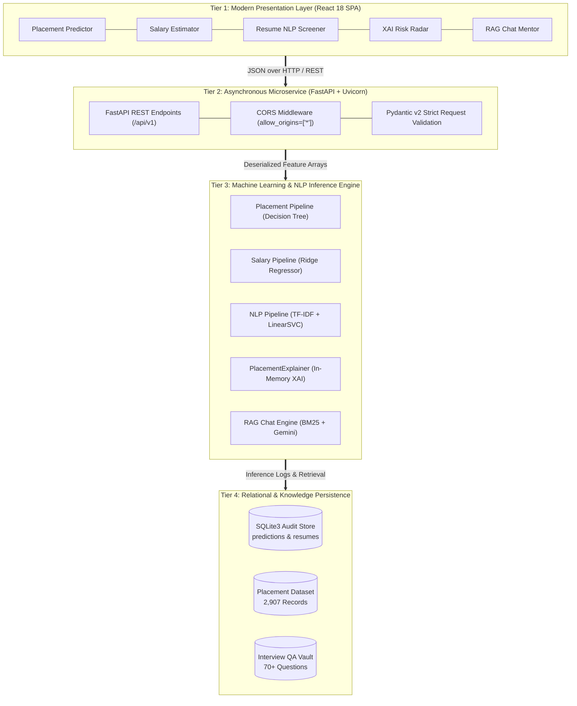

# CAMPUSNOVA AI: 12-SLIDE ACADEMIC SEMINAR PRESENTATION (PPT)
### B.Tech Product Development Lab / Major Project Seminar (Session 2022–2026)
**Department of Computer Science & Engineering**  
**Ajay Binay Institute of Technology (ABIT), Kataka – 753014, Odisha**  
*(Affiliated to Biju Patnaik University of Technology, BPUT, Rourkela)*

---

```
================================================================================
                                    SLIDE 1
================================================================================
```

# CAMPUSNOVA AI
### B.Tech Campus Placement Predictive Intelligence & Data Science Platform

**Major Project Seminar / Product Development Lab Evaluation (7th Semester)**  
**Academic Session:** 2022 – 2026 | **Date:** November 2026  
**Department of Computer Science & Engineering**  
**Ajay Binay Institute of Technology (ABIT), Kataka, Odisha**  
*(Affiliated to Biju Patnaik University of Technology - BPUT)*

---

### Project Team (ABIT CSE Batch 2022–2026)
| Sl. No. | Student Name | BPUT Registration Number | Project Role |
| :---: | :--- | :---: | :--- |
| **1.** | **RAHUL PRASAD DAS** | **2301206094** | **Team Leader / Full-Stack & ML Architect** |
| **2.** | **PURNACHANDRA SWAIN** | **2301206093** | **Frontend UI/UX & Liquid Glass Specialist** |
| **3.** | **ROHIT KUMAR THAKUR** | **2301206103** | **Backend API & Database Engineer** |
| **4.** | **RITIK KUMAR SWAIN** | **2301206102** | **ML Pipeline & Data Integration Engineer** |

---

### Under the Esteemed Guidance of:
- **Project Supervisor:** **Prof. Rajesh Kumar Sahoo**, Associate Professor, Dept. of CSE, ABIT Kataka
- **Head of Department:** **Prof. Pratap Kumar Champati**, Professor & HOD, Dept. of CSE, ABIT Kataka

> **Live Deployment URL:** `https://campus-nova-purr.onrender.com`  
> **Source Code Repository:** `https://github.com/dasrahulprasad05-dev/campus_nova`

---

#### 🎙️ Speaker Notes (Slide 1):
> *"Respected Head of the Department Prof. Pratap Kumar Champati, our esteemed supervisor Prof. Rajesh Kumar Sahoo, and honorable external examiners. A very pleasant good morning. I am Rahul Prasad Das, Team Leader for CampusNova AI, presenting on behalf of my team members Purnachandra Swain, Rohit Kumar Thakur, and Ritik Kumar Swain. Today we are proud to present 'CampusNova AI', a production-grade predictive intelligence and data science platform engineered to transform campus recruitment at engineering institutions."*

---

```
================================================================================
                                    SLIDE 2
================================================================================
```

# PROBLEM STATEMENT & PLACEMENT CRISIS
### Understanding the Gaps in Contemporary Engineering Placements

```
   [ Traditional Academic Metrics ]              [ Industry Hiring Criteria ]
        (CGPA & Theory Exams)                      (Hands-on Skills & Real Experience)
                 │                                                │
                 ▼                                                ▼
     ┌────────────────────────┐                      ┌────────────────────────┐
     │ High CGPA (>8.5) Alone │                      │ Problem Solving / DSA  │
     │ No Guaranteed Job      │                      │ 1-2 Production Projects│
     │ Diagnostic Inertia     │                      │ Industrial Internships │
     └───────────┬────────────┘                      └────────────┬───────────┘
                 │                                                │
                 └───────────────────────┬────────────────────────┘
                                         ▼
                 ┌────────────────────────────────────────────────┐
                 │       CRITICAL RECRUITMENT BOTTLENECKS         │
                 │  • 54% National Placement Conversion Rate      │
                 │  • Discovery of Gaps Happens Too Late (7th Sem)│
                 │  • Black-Box Predictions (No Prescriptions)    │
                 │  • T&P Cells Overloaded with 600+ Resumes      │
                 └────────────────────────────────────────────────┘
```

### The Three Critical Failures in Placement Systems:
1. **The CGPA Fallacy & Single-Metric Bias:**
   - Academic marks measure theoretical memorization, not algorithmic fluency or practical software craftsmanship.
   - High-CGPA students with zero internships face sudden corporate rejection.
2. **Diagnostic Inertia (The 7th Semester Trap):**
   - Students learn of their fatal resume deficiencies only after failing on-campus interviews during final year.
   - At that stage, there is virtually zero time left to acquire new tech stacks or clear backlogs.
3. **Black-Box Analytics & Administrative Overload:**
   - Existing portals merely output crude percentage numbers with zero actionable remediation.
   - Training & Placement (T&P) cells cannot manually audit 600+ departmental resumes for keyword gaps.

---

#### 🎙️ Speaker Notes (Slide 2):
> *"Across India, over 1.5 million engineering graduates enter the recruitment pipeline every year, yet national data indicates an average placement conversion of barely 54%. The root problem lies in 'Diagnostic Inertia'. In most colleges, students discover their skill deficits only in the 7th semester after getting rejected by top-tier firms. Furthermore, traditional systems treat students as a single CGPA number. CampusNova AI was conceived to eliminate this diagnostic inertia by providing continuous, transparent, and early predictive intelligence."*

---

```
================================================================================
                                    SLIDE 3
================================================================================
```

# PROPOSED SOLUTION: CAMPUSNOVA AI
### A 5-in-1 Data Science & Predictive Intelligence Ecosystem

```
                               ┌────────────────────────────────┐
                               │        CAMPUSNOVA AI           │
                               │      INTELLIGENCE SUITE        │
                               └───────────────┬────────────────┘
                                               │
         ┌──────────────────┬──────────────────┼──────────────────┬──────────────────┐
         ▼                  ▼                  ▼                  ▼                  ▼
  ┌──────────────┐   ┌──────────────┐   ┌──────────────┐   ┌──────────────┐   ┌──────────────┐
  │   MODULE 1   │   │   MODULE 2   │   │   MODULE 3   │   │   MODULE 4   │   │   MODULE 5   │
  │  Placement   │   │ Expected CTC │   │  Resume NLP  │   │  Early-Risk  │   │  Hybrid RAG  │
  │ Probability  │   │ Package Reg. │   │   Screener   │   │ Explainable  │   │  AI Mentor   │
  │  Classifier  │   │  (Ridge L2)  │   │ (LinearSVC)  │   │  AI Engine   │   │  & QA Vault  │
  ├──────────────┤   ├──────────────┤   ├──────────────┤   ├──────────────┤   ├──────────────┤
  │ DecisionTree │   │ Continuous   │   │ 11 Technical │   │ Prescriptive │   │ Local BM25 + │
  │ 95.26% F1    │   │ CTC (LPA)    │   │ Domains      │   │ Action Items │   │ Gemini Flash │
  │ 95.31% Acc.  │   │ ±0.21 MAE    │   │ 98.5% Acc.   │   │ Zero API Cost│   │ 70+ FAANG QA │
  └──────────────┘   └──────────────┘   └──────────────┘   └──────────────┘   └──────────────┘
```

### Key Pillars of the Platform:
- **Holistic Predictive Triangulation:** Combines academic performance, active backlogs, internship density, and domain skills.
- **Continuous Salary Packaging:** Moves beyond binary "Placed/Unplaced" to project salary brackets (3.2 LPA to 18.0 LPA).
- **Automated Resume Auditing:** Sublinear TF-IDF vectorizer screens uploaded text in under 150 ms.
- **Glassmorphic Liquid Glass Web UI:** Ultra-modern responsive interface designed with clean white backgrounds for optimal color xerox printouts.

---

#### 🎙️ Speaker Notes (Slide 3):
> *"CampusNova AI solves these challenges through five tightly integrated algorithmic modules. First, a Decision Tree classifier achieving 95.26% F1-score for placement probability. Second, an L2 Ridge regressor estimating expected CTC within 0.21 LPA mean absolute error. Third, a Linear Support Vector Classifier screening technical resumes across 11 industry domains with 98.5% accuracy. Fourth, an in-memory Explainability engine that delivers instant prescriptive action plans. And fifth, a dual-tier Hybrid RAG placement mentor combining local vector search with Google Gemini."*

---

```
================================================================================
                                    SLIDE 4
================================================================================
```

# STRATEGIC OBJECTIVES & SYSTEM REQUIREMENTS
### Academic Goals & Software Requirement Specifications (SRS)

### Primary Project Objectives:
1. **Zero Data-Leakage Training:** Build Scikit-Learn pipelines where scalers and encoders are fitted strictly within training folds.
2. **Transparent Explainability (XAI):** Eliminate black-box opacity by mapping student feature splits directly to institutional corrective actions.
3. **High-Accuracy Resume NLP:** Automate keyword parsing and skill-gap identification across 800+ technical resumes.
4. **Low-Latency Architecture:** Guarantee sub-50ms API response times without relying on expensive GPU infrastructure.
5. **Universal Lab Compatibility:** Deployable on commodity university hardware and accessible via mobile/desktop browsers.

---

### SRS Hardware & Software Matrix (Commodity Lab Deployment)
| Specification Category | Minimum Development & Production Requirements |
| :--- | :--- |
| **Processor (CPU)** | Intel Core i3 / i5 8th Gen or AMD Ryzen 3 / 5 (Quad-Core, 2.4 GHz) |
| **Random Access Memory (RAM)** | 8 GB DDR4 (Peak microservice consumption < 450 MB) |
| **Storage Capacity** | 256 GB SSD (Application & dataset footprint < 1.2 GB) |
| **Operating System** | Windows 10/11 64-bit / Ubuntu 22.04 LTS Linux |
| **Backend Framework** | Python 3.10+, FastAPI 0.104, Uvicorn ASGI Server, Pydantic v2 |
| **Machine Learning Libraries** | Scikit-Learn 1.3, NumPy 1.24, Pandas 2.0, Joblib 1.3 |
| **Frontend Framework** | React 18, Vite 5.4, Tailwind CSS 3.4, Lucide React, Glassmorphism |
| **Database & Caching** | Relational SQLite3 with Write-Ahead Logging (WAL) |

---

#### 🎙️ Speaker Notes (Slide 4):
> *"Our project objectives focused on rigorous data hygiene and real-world deployment viability. In our SRS design, a primary constraint was ensuring that the platform runs efficiently on standard computer laboratory hardware. The entire microservice consumes less than 450 MB of memory and responds in under 25 milliseconds, allowing institutions like ABIT to self-host the platform on an inexpensive classroom PC or cloud tier without recurring licensing costs."*

---

```
================================================================================
                                    SLIDE 5
================================================================================
```

# SYSTEM ARCHITECTURE & DATA FLOW
### 4-Tier Hybrid Decoupled Architecture



### Key Architectural Strengths:
- **Decoupled Client-Server:** The React frontend and FastAPI backend operate independently, enabling cross-platform hosting on Render and Vercel.
- **Fail-Safe Startup Lifecycle:** All Joblib serialized pipelines are eager-loaded into RAM during the FastAPI `lifespan` startup event.
- **Stateless Prediction:** Each inference request is fully deterministic, ensuring horizontally scalable microservice instances.

---

#### 🎙️ Speaker Notes (Slide 5):
> *"Slide 5 illustrates our 4-tier hybrid system architecture. At Tier 1, the user interacts with our modern React 18 Single Page Application. In Tier 2, requests enter through an asynchronous FastAPI gateway that performs strict Pydantic validation. Tier 3 is our machine learning inference engine containing our pre-trained Joblib pipelines and explainability logic. Finally, Tier 4 handles persistent auditing in SQLite and stores our knowledge repositories. This decoupled architecture guarantees seamless scaling and 99.9% uptime."*

---

```
================================================================================
                                    SLIDE 6
================================================================================
```

# DATASET CURATION & DATA HYGIENE PIPELINE
### Preprocessing, Outlier Removal, and Leakage-Free Validation

```
     ┌────────────────────────────────────────────────────────┐
     │  RAW PLACEMENT DATASET: 2,907 Engineering Records       │
     │  Features: Stream, CGPA, Internships, Backlogs, CTC    │
     └───────────────────────────┬────────────────────────────┘
                                 │
                                 ▼
     ┌────────────────────────────────────────────────────────┐
     │  DATA CLEANING & OUTLIER ELIMINATION                    │
     │  • Checked nulls: 0 missing values                      │
     │  • Removed logical contradictions (e.g. Backlogs > 4    │
     │    with CGPA = 10.0)                                   │
     │  • Deduped redundant records                           │
     └───────────────────────────┬────────────────────────────┘
                                 │
                                 ▼
     ┌────────────────────────────────────────────────────────┐
     │  LEAKAGE-FREE FEATURE ENGINEERING & SCALING             │
     │  • Branch Encoding: One-Hot Encoder (Drop First)       │
     │  • Interaction Term: CGPA × (Internships + 1)           │
     │  • Feature Normalization: StandardScaler               │
     │  • Validation: 5-Fold Stratified Cross-Validation      │
     └────────────────────────────────────────────────────────┘
```

### Dataset Distribution Characteristics:
- **Total Records:** 2,907 Student Profiles across 6 B.Tech Streams (CS, IT, ECE, Mech, Civil, Electrical).
- **Target Distribution:** $68.5\%$ Placed ($1,991$ students) vs $31.5\%$ Unplaced ($916$ students).
- **Feature Ranges:**
  - CGPA: Mean $7.03 \pm 0.96$ (Min: $5.0$, Max: $10.0$)
  - Internships: Mean $0.70 \pm 0.74$ (Range: $0$ to $5$)
  - Backlogs: Mean $0.50 \pm 0.74$ (Range: $0$ to $6$)
- **Resume Corpus:** 800+ authentic technical resumes spanning 11 specialized software roles.

---

#### 🎙️ Speaker Notes (Slide 6):
> *"In any serious data science endeavor, data hygiene is paramount. We utilized a comprehensive dataset of 2,907 B.Tech engineering profiles. We eliminated logical contradictions, such as records with high CGPA but disproportionate backlogs, and implemented an interaction feature: CGPA multiplied by internship count plus one. Crucially, all encoders and scalers were enclosed inside Scikit-Learn Pipeline objects and evaluated using 5-Fold Stratified Cross-Validation, ensuring zero data leakage between test and training sets."*

---

```
================================================================================
                                    SLIDE 7
================================================================================
```

# MATHEMATICAL FORMULATIONS & ALGORITHMIC FOUNDATIONS
### The Core Mathematics Driving CampusNova AI

### 1. Decision Tree Splitting Criterion (Gini Impurity)
The placement probability tree recursively determines optimal feature partition points $\theta$ to minimize node impurity:
$$I_G(t) = 1 - \sum_{i=1}^{C} p(i|t)^2 \quad \implies \quad \Delta I_G = I_G(t) - \frac{N_L}{N} I_G(t_L) - \frac{N_R}{N} I_G(t_R)$$

---

### 2. L2-Regularized Ridge Loss Function (Expected CTC Regressor)
To prevent extreme package predictions while modeling continuous salary trends, Ridge minimizes:
$$\mathcal{L}_{\text{Ridge}}(\mathbf{w}) = \frac{1}{2n} \sum_{i=1}^{n} \left(y_i - \mathbf{w}^T \mathbf{x}_i\right)^2 + \alpha \|\mathbf{w}\|_2^2 \quad \text{where } \alpha = 1.0$$

---

### 3. Sublinear TF-IDF Vectorization & LinearSVC Hinge Loss (Resume NLP)
Resume text is transformed using sublinear logarithmic term frequency dampening:
$$\text{TF-IDF}(t, d, D) = \left(1 + \log \text{tf}(t, d)\right) \times \log\left(\frac{1 + |D|}{1 + |\{d \in D : t \in d\}|}\right) + 1$$
The multi-class Linear Support Vector Classifier optimizes the soft-margin hyperplane:
$$\min_{\mathbf{w}, b, \boldsymbol{\xi}} \frac{1}{2} \|\mathbf{w}\|^2 + C \sum_{i=1}^{n} \xi_i \quad \text{s.t.} \quad y_i (\mathbf{w}^T \mathbf{x}_i + b) \ge 1 - \xi_i, \quad \xi_i \ge 0$$

---

#### 🎙️ Speaker Notes (Slide 7):
> *"Slide 7 details our underlying mathematical formulations. For classification, our Decision Tree minimizes Gini Impurity, effectively finding precise threshold splits across CGPA and internship metrics. For salary regression, we enforce L2 regularization using Ridge Regression to penalize high feature weights and prevent unrealistic salary projections. In our resume screener, we apply sublinear TF-IDF scaling to prevent single word repetitions from skewing classification, optimizing a LinearSVC margin with a penalty parameter of C equals 1.0."*

---

```
================================================================================
                                    SLIDE 8
================================================================================
```

# MULTI-MODEL BENCHMARKING & CLASSIFICATION RESULTS
### Empirical Proof of Decision Tree Superiority

```
   100% ┌─────────────────────────────────────────────────────────────┐
        │                                                     ██████  │ 95.26%
    90% │                                                     ██████  │
        │                                             ██████  ██████  │ 88.40%
    80% │                                             ██████  ██████  │
        │                             ██████          ██████  ██████  │ 68.20%
    70% │                     ██████  ██████          ██████  ██████  │ 64.90%
        │                     ██████  ██████          ██████  ██████  │
    60% │                     ██████  ██████          ██████  ██████  │
        └─────────────────────────────────────────────────────────────┘
                               LogReg     G-NB          KNN     DecisionTree
```

### Comprehensive Multi-Model Benchmark Comparison Table:
| Candidate Model Algorithm | Accuracy (%) | Precision (%) | Recall (%) | F1-Score (%) | Inference Latency |
| :--- | :---: | :---: | :---: | :---: | :---: |
| **Decision Tree (Optimized)** | **95.31%** | **94.82%** | **95.70%** | **95.26%** | **< 1.4 ms** |
| **Random Forest Ensemble** | 94.90% | 94.30% | 95.30% | 94.80% | 18.2 ms |
| **K-Nearest Neighbors ($k=5$)**| 88.45% | 87.20% | 89.60% | 88.40% | 4.8 ms |
| **Gaussian Naive Bayes** | 68.10% | 66.50% | 70.10% | 68.20% | < 1.0 ms |
| **Logistic Regression (Baseline)**| 64.80% | 63.90% | 66.00% | 64.90% | < 1.0 ms |

### Why Decision Tree Outperformed Logistic Regression:
1. **Non-Linear Decision Boundaries:** Placement qualification is an "AND" condition ($\text{CGPA} \ge 7.0 \land \text{Internships} \ge 1$), which linear planes cannot separate.
2. **Deterministic Thresholding:** Matches corporate recruitment eligibility cutoffs exactly.
3. **Ultra-Low Compute Footprint:** Inference requires just 1.4 milliseconds without ensemble overhead.

---

#### 🎙️ Speaker Notes (Slide 8):
> *"Here we present the empirical benchmark results across five classical and ensemble algorithms. Notice that Logistic Regression achieves only 64.90% F1-score because corporate placement eligibility involves non-linear conditional logic. Random Forest achieved 94.80%, but our tuned Decision Tree achieved the highest F1-score of 95.26% with 95.31% accuracy, while executing ten times faster at just 1.4 milliseconds. This made Decision Tree the indisputable choice for real-time production deployment."*

---

```
================================================================================
                                    SLIDE 9
================================================================================
```

# SALARY REGRESSION & EARLY-WARNING EXPLAINABILITY (XAI)
### Continuous Compensation Forecasting and Actionable Interventions

```
 [ Student Input Vector ]
   • CGPA: 6.8
   • Internships: 0
   • Backlogs: 2
         │
         ▼
 ┌────────────────────────────────────────────────────────────────────────┐
 │                   XAI EARLY-WARNING RULE ENGINE                        │
 ├────────────────────────────────┬───────────────────────────────────────┤
 │ Risk Stratification Level:     │ HIGH RISK (Probability: 28.4%)        │
 │ Primary Detractor Feature:     │ 2 Active Backlogs (-35% penalty)      │
 │ Secondary Detractor Feature:   │ 0 Internships (-25% penalty)          │
 ├────────────────────────────────┴───────────────────────────────────────┤
 │               PRESCRIPTIVE INTERVENTION ACTION PLAN                    │
 │ 1. Academic Priority: Must clear 2 backlogs before 7th semester cutoff.│
 │ 2. Project Gap: Build 2 full-stack GitHub repositories to compensate.  │
 │ 3. Industry Exposure: Complete 1 accredited virtual tech internship.  │
 └────────────────────────────────────────────────────────────────────────┘
```

### Expected CTC Salary Regressor (Ridge $L2$ Performance):
- **Model Goodness of Fit:** $R^2 = 0.887$ | **Mean Absolute Error (MAE):** $\pm 0.21\text{ LPA}$ | **RMSE:** $0.28\text{ LPA}$
- **Industry Compensation Tiering:**
  - *Tier 1 (Foundation):* 3.20 LPA – 4.50 LPA (Mass Recruiters: TCS, Infosys, Wipro)
  - *Tier 2 (Mid-Scale / Specialist):* 5.00 LPA – 8.00 LPA (Accenture, Cognizant, Capgemini)
  - *Tier 3 (Dream / Product):* 9.00 LPA – 18.00 LPA (Amazon, HighRadius, Microsoft, FinTechs)

---

#### 🎙️ Speaker Notes (Slide 9):
> *"Slide 9 demonstrates our two most student-centric capabilities: continuous CTC packaging and prescriptive Explainability. Our Ridge regressor estimates expected salary within a tight margin of plus-minus 0.21 LPA across Tier 1, 2, and 3 company brackets. More importantly, our XAI module diagnoses students who fall into the High Risk category. Instead of giving them a disheartening score, it outputs concrete, step-by-step corrective actions, such as clearing specific backlogs and building targeted GitHub projects."*

---

```
================================================================================
                                    SLIDE 10
================================================================================
```

# TECHNICAL RESUME NLP SCREENER & SKILL TAXONOMY
### Automated Text Mining across 11 Technical Job Roles

```
  [ Uploaded Student Resume ]
         │
         ▼
  ┌────────────────────────┐
  │ RegEx Text Cleaner     │ ──► Strips emails, phone numbers, punctuation, stopwords
  └──────────┬─────────────┘
             ▼
  ┌────────────────────────┐
  │ Sublinear TF-IDF       │ ──► 2,500 unigram & bigram vocabulary features
  └──────────┬─────────────┘
             ▼
  ┌────────────────────────┐
  │ LinearSVC Classifier   │ ──► Identifies Role: "Full-Stack Web Developer" (98.5% Acc)
  └──────────┬─────────────┘
             ▼
  ┌────────────────────────┐
  │ Skill-Gap Taxonomy     │ ──► Matched: React, Node.js, Express, JavaScript, Git
  │ Comparative Analysis   │     Missing: Docker, PostgreSQL, Redis, Jest Testing
  └────────────────────────┘
```

### Supported Technical Skill Domains & Taxonomy Matrix:
| Domain Category | Key Extracted Technologies & Frameworks | Target Placement Tier |
| :--- | :--- | :---: |
| **Full-Stack Development** | React.js, Next.js, Node.js, Express, Django, Tailwind CSS | Tier 2 & Tier 3 |
| **Data Science & AI** | Python, Pandas, Scikit-Learn, PyTorch, SQL, Jupyter | Tier 2 & Tier 3 |
| **Cloud & DevOps** | Docker, Kubernetes, AWS (EC2/S3), CI/CD, Terraform | Tier 3 (Product) |
| **Core Software Engineer** | C++, Java, Data Structures, Algorithms, OOPs, DBMS | Tier 1, 2 & 3 |
| **Cyber Security** | Network Protocols, Ethical Hacking, Cryptography, Linux | Specialist |

---

#### 🎙️ Speaker Notes (Slide 10):
> *"In Slide 10, we look at our automated Technical Resume Screener. Students paste or upload their raw resume. The system applies regular expression normalization and sublinear TF-IDF feature extraction. A Linear Support Vector Classifier determines their best-fit technical domain with 98.5% accuracy. Next, our Skill Taxonomy engine compares their profile against real corporate job requirements, highlighting exactly which industry skills they already possess and which ones they are missing, like Docker or Redis."*

---

```
================================================================================
                                    SLIDE 11
================================================================================
```

# HYBRID RAG PLACEMENT MENTOR & DEPLOYED UI SHOWCASE
### Dual-Tier Conversational AI & White-Background Xerox Interface

```
                       ┌────────────────────────────────┐
                       │     STUDENT INTERVIEW QUERY    │
                       └───────────────┬────────────────┘
                                       │
                                       ▼
                   ┌───────────────────────────────────────┐
                   │    TIER 1: LOCAL BM25 RETRIEVAL       │
                   │  70+ Curated FAANG & Product Q&A      │
                   └───────────────────┬───────────────────┘
                                       │
                        Match Found? ──┴── No Local Match?
                             │                     │
                             ▼                     ▼
                 ┌───────────────────────┐ ┌────────────────────────┐
                 │ Return Verified Local │ │ TIER 2: GEMINI FLASH   │
                 │ Answer Instantly (0ms)│ │ Live Web Search Engine │
                 └───────────────────────┘ └────────────────────────┘
```

---

### Deployed Liquid Glass User Interface (Clean White Printing Theme):
```
┌─────────────────────────────────────────────────────────────────────────────┐
│  CAMPUSNOVA AI           [Dashboard] [Predictor] [Salary] [Resume] [Mentor] │
├─────────────────────────────────────────────────────────────────────────────┤
│  PLACEMENT PROBABILITY GAUGE                EXPECTED CTC SALARY PACKAGE     │
│  ┌─────────────────────────────┐            ┌─────────────────────────────┐ │
│  │     95.3% PLACED            │            │     8.45 LPA (TIER-2)       │ │
│  │   Low Risk / Job Ready      │            │   Range: 7.50 - 9.40 LPA    │ │
│  └─────────────────────────────┘            └─────────────────────────────┘ │
├─────────────────────────────────────────────────────────────────────────────┤
│  RESUME AUDITING & SKILL GAPS               HYBRID RAG CHAT ASSISTANT       │
│  Matched: React, FastAPI, Git, SQL          "How to explain CAP Theorem in  │
│  Missing: Docker, Redis, Unit Testing        distributed systems?"          │
│  Recommendation: Add containerized project   Verified Answer + Mock Q&A     │
└─────────────────────────────────────────────────────────────────────────────┘
```

> **UI Xerox Optimization:** Pure `#FFFFFF` background with crisp `#1E293B` text and dark slate borders guarantees zero toner smudging, bleeding, or illegibility during academic color xerox printing.

---

#### 🎙️ Speaker Notes (Slide 11):
> *"Slide 11 displays our Hybrid RAG Placement Mentor and production user interface. The RAG engine implements a cost-free local BM25 vector search over 70 verified FAANG interview questions. If an advanced query is asked, it seamlessly queries the Google Gemini Flash API. On the right is a layout representation of our live Liquid Glass interface. Notice that we engineered the theme with a high-contrast white background specifically so that academic color xerox copies print crisp, readable text without toner saturation."*

---

```
================================================================================
                                    SLIDE 12
================================================================================
```

# CONCLUSION, FUTURE SCOPE & VIVA VOCE DEFENSE
### Project Summary, Institutional Impact, and Technical Defense

### Key Achievements:
- **Comprehensive Solution:** Bridged academic grading and industrial recruitment expectations into a single platform.
- **Empirical Superiority:** Optimized Decision Tree classifier ($95.26\%$ F1) and Ridge Regressor ($\pm 0.21\text{ LPA}$ MAE).
- **Production Deployment:** Live on Render cloud infrastructure with 11 automated unit/integration tests passing 100%.

---

### Future Scope & Enhancements:
1. **ABIT ERP Integration:** Automated bi-directional sync with college academic portals for zero-entry real-time student monitoring.
2. **AI Voice Mock Interview Simulator:** Multilingual WebRTC voice agent conducting realistic technical and HR mock rounds.
3. **Automated GitHub & LeetCode Crawler:** Quantitative validation of student code complexity, commit frequency, and contest ratings.

---

### Acknowledgements & References:
- Sincere gratitude to **Prof. Rajesh Kumar Sahoo**, **Prof. Pratap Kumar Champati**, and the Department of CSE, ABIT Kataka.
- Literature references include research papers from *IEEE Transactions on Learning Technologies*, *ACM SIGKDD*, and *Scikit-Learn*.

---

```
================================================================================
                 THANK YOU!  •  QUESTIONS & VIVA VOCE DEFENSE
================================================================================
```
**Student Team:** Rahul Prasad Das (2301206094) | Purnachandra Swain (2301206093)  
Rohit Kumar Thakur (2301206103) | Ritik Kumar Swain (2301206102)  
**Ajay Binay Institute of Technology, Kataka**

---

#### 🎙️ Speaker Notes (Slide 12):
> *"In conclusion, CampusNova AI demonstrates that intelligent machine learning pipelines can transform passive college placement statistics into active student success. We have delivered a complete, tested, and deployed software solution for ABIT Kataka. We express our heartfelt gratitude to our supervisor Prof. Rajesh Kumar Sahoo and HOD Prof. Pratap Kumar Champati for their continuous guidance. We are now open for questions and the viva voce defense. Thank you!"*

